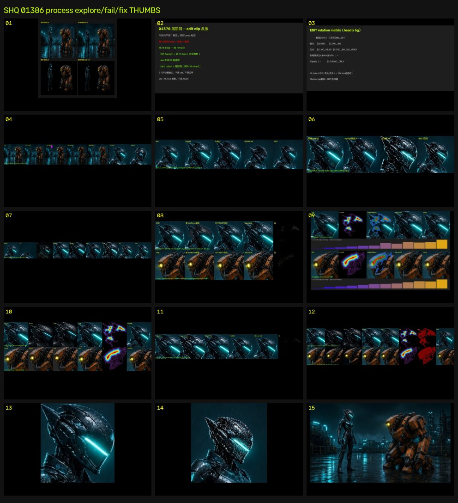
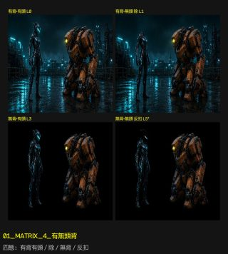
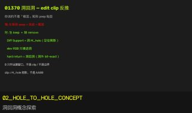
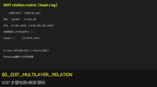
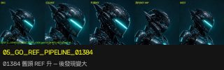
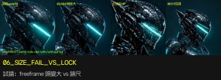
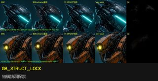
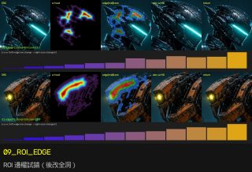
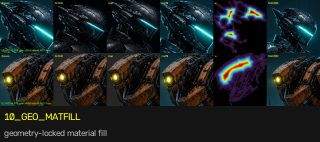
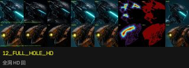

# Process thumbs · 探索 / 試錯 / 修正（01386）

縮圖對應洞·除·扣·生鏈上的探索與走錯，非整圖交付。

| # | thumb | 說明 |
|---|-------|------|
| 1 |  | **01_MATRIX_4_有無頭背** 四態：有背有頭 / 除 / 無背 / 反扣 |
| 2 |  | **02_HOLE_TO_HOLE_CONCEPT** 洞回洞概念探索 |
| 3 |  | **03_EDIT_MULTILAYER_RELATION** EDIT 多層有頭×無頭 關係 |
| 4 |  | **04_HOLE_INPAINT_PIPELINE** 洞內 INPAINT 鏈 |
| 5 |  | **05_GO_REF_PIPELINE_01384** 01384 舊頭 REF 升 — 後發現變大 |
| 6 |  | **06_SIZE_FAIL_VS_LOCK** 試錯：freeframe 頭變大 vs 鎖尺 |
| 7 |  | **07_ANTI_4STATE_BOARD** 洞除扣生全鏈 + 反查 |
| 8 |  | **08_STRUCT_LOCK** 結構鎖洞探索 |
| 9 |  | **09_ROI_EDGE** ROI 邊權試錯（後改全洞） |
| 10 |  | **10_GEO_MATFILL** geometry-locked material fill |
| 11 |  | **11_POSELOCK_DENSIFY** pose-lock densify 試 |
| 12 |  | **12_FULL_HOLE_HD** 全洞 HD 回 |
| 13 |  | **13_PEEP_LOCKED** 鎖尺 peep 洞框 |
| 14 |  | **14_ZOOM_BEST_SCALELOCK** 鎖尺回洞 zoom |
| 15 |  | **15_BEST_RETURN_SCALELOCK** 鎖尺 BEST 全圖（縮圖） |

## 敘事順序

1. 四態矩陣 / 洞回洞概念 / EDIT 多層
2. 洞內 INPAINT · 舊頭 REF（01384）
3. **試錯：頭變大** SIZE_FAIL_VS_LOCK
4. 四態反查 · 結構鎖 · ROI · matfill 旁路探索
5. 鎖尺 peep → BEST 回洞

asof: 2026-11-07T16:16:46.418366+00:00
ACCEPT_FULL_HD: false
